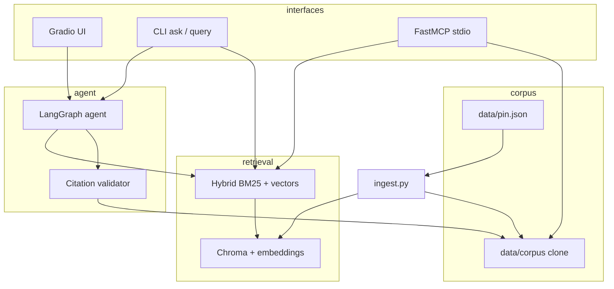

# Codebase Q&A Agent

Answer questions about a **fixed snapshot** of the public [LangGraph](https://github.com/langchain-ai/langgraph) repository with **file-and-line citations** grounded in retrieved source and docs.

This is an **unofficial demo project** — not affiliated with or endorsed by LangChain.

---

## Overview

The agent combines **hybrid retrieval** (BM25 + dense vectors), a **LangGraph** reasoning loop, and a **programmatic citation validator** so claims must map to real paths and line ranges in the pinned corpus. You can use it from the command line, a local **Gradio** UI, or an **MCP** server for editor integration.

The corpus is **reproducible**: `data/pin.json` records an exact Git commit and which paths are indexed (`libs/langgraph`, `docs`). Index artifacts are built locally and are not committed to this repository.

**Typical flows**

| Goal | What to run | LLM API key |
|------|-------------|-------------|
| Try search quality | `make query` | Not required |
| Cited natural-language answers | `make ask` | Required |
| Browser UI | `make ui` | Required for **Ask** tab only |
| IDE tools (search / read file) | `make mcp` | Not required |
| Measure retrieval | `make eval` | Not required |

---

## Features

- **Pinned corpus** — clone and chunk a single upstream commit; evals stay comparable across machines.
- **Hybrid RAG** — reciprocal rank fusion of BM25 and Chroma vector search; optional cross-encoder rerank (off by default; see [Evaluation](#evaluation)).
- **LangGraph agent** — retrieve, grade evidence, reformulate queries (up to two rounds), draft structured answers, validate citations, then reply or refuse.
- **Golden retrieval evals** — hand-curated questions in `evals/golden.jsonl` with expected file targets.
- **FastMCP** — `search_code`, `search_docs`, and `read_file` over the same index (stdio transport).
- **Gradio UI** — cited **Ask** mode plus retrieval-only **Search** mode.

---

## How it works



| Layer | Responsibility | Main code |
|-------|----------------|-----------|
| Corpus | Pin SHA, clone, AST/doc chunking | `ingest.py`, `corpus.py`, `chunking.py` |
| Retrieval | Vector + BM25 search, optional rerank | `retrieval.py`, `langchain_rag.py`, `bm25_index.py` |
| Agent | Retrieve → draft → validate → answer | `agent.py`, `validate.py`, `answer_schemas.py` |
| Interfaces | CLI, web UI, MCP | `agent_cli.py`, `query_cli.py`, `gradio_app.py`, `mcp_server.py` |

**Indexing**

- Python: AST-based chunks with accurate `path:start-end` metadata.
- Docs: Markdown header splitting via LangChain.
- Embeddings: local `sentence-transformers/all-MiniLM-L6-v2` (no OpenAI key for ingest or search).
- Vector store: persistent **Chroma** under `CHROMA_PATH`; BM25 metadata in `data/chroma/bm25_meta.json`.

**Agent loop (simplified)** — hybrid search → if evidence is thin, reformulate and search again (≤2 rounds) → LLM draft with structured citations → validator checks disk + retrieval overlap → markdown answer or explicit “I don’t know”.

---

## Prerequisites

- **Python 3.12+**
- **[uv](https://docs.astral.sh/uv/)** (recommended) or `pip` with a virtualenv
- **Git** (ingest clones LangGraph)
- **Disk** — a few GB for corpus, Chroma, and embedding models
- **OpenAI or Anthropic API key** — only for `make ask` / Gradio **Ask** (see [Configuration](#configuration))

First ingest is usually **5–15 minutes**, depending on network and CPU.

---

## Getting started

### 1. Clone and install

```bash
cd codebase_qa_agent
uv venv .venv && source .venv/bin/activate
make install
```

`make install` creates `.venv`, installs the package with `dev`, `ml`, and `ui` extras, and copies `.env.example` → `.env` if `.env` is missing.

### 2. Configure secrets (for the agent only)

```bash
# Edit .env — never commit this file
# Set OPENAI_API_KEY and/or ANTHROPIC_API_KEY
# Set LLM_PROVIDER=openai or anthropic
```

Retrieval, eval, and MCP search tools do **not** need an LLM key.

```bash
make check-env   # prints whether an LLM key is visible (not the key itself)
```

### 3. Build the index

```bash
make ingest
```

This clones the pinned commit into `data/corpus/` (gitignored), chunks it, embeds, and writes `data/chroma/`. Commit metadata is recorded in `data/pin.json`.

### 4. Smoke test

```bash
make query Q="How does checkpointing work?"
make ask Q="How does checkpointing work?"    # requires LLM key
make test
```

---

## Usage

### Makefile targets

| Command | Description |
|---------|-------------|
| `make help` | List targets |
| `make install` | Virtualenv + dependencies |
| `make check-env` | LLM and Chroma path sanity check |
| `make ingest` | Clone, chunk, index |
| `make query Q="..."` | Hybrid retrieval only (prints top chunks) |
| `make ask Q="..."` | Full agent with citations |
| `make eval` | Golden-set retrieval metrics → `eval-results.md` |
| `make test` | Pytest suite |
| `make ui` | Gradio on http://127.0.0.1:7860 |
| `make mcp` | MCP server on stdio (for Cursor / other hosts) |

Equivalent console scripts: `codebase-ingest`, `codebase-query`, `codebase-ask`, `codebase-ui`, `codebase-mcp`.

### Gradio web UI

```bash
make ui
```

- **Ask** — LangGraph agent with validated citations (LLM required; first request may take 20–60s while models load).
- **Search** — hybrid retrieval only (no LLM cost).

Temporary public link: `GRADIO_SHARE=true make ui`.

### MCP (Cursor and other clients)

Tools: `search_code`, `search_docs`, `read_file`. Same index as `make query`; no LLM required.

1. Complete `make ingest`.
2. Add the server from [`.mcp.json.example`](.mcp.json.example) to your MCP config (adjust the Python path if needed).
3. Restart the host — server name **`langgraph-codebase`**.

```bash
make mcp    # blocks on stdio; Ctrl+C to exit
```

MCP uses the **Model Context Protocol** over stdio; any host that can launch a local `command` + `args` can use the same entry (e.g. Claude Desktop, many IDE extensions).

### Deploying to Hugging Face Spaces

The repo root [`app.py`](app.py) is the Space entrypoint. The index is **not** in git; you must ingest once on the Space or attach persistent storage. See [`deploy/huggingface/README.md`](deploy/huggingface/README.md).

---

## Configuration

Environment variables are loaded from `.env` at the project root (see [`.env.example`](.env.example)). Important settings:

| Variable | Default | Purpose |
|----------|---------|---------|
| `LLM_PROVIDER` | `openai` | `openai` or `anthropic` |
| `OPENAI_API_KEY` / `ANTHROPIC_API_KEY` | — | Agent and Gradio Ask |
| `CHROMA_PATH` | `data/chroma` | Resolved relative to project root |
| `EMBEDDING_MODEL` | `sentence-transformers/all-MiniLM-L6-v2` | Ingest + search |
| `RETRIEVAL_MODE` | `hybrid` | `hybrid` or `vector` |
| `RERANK_ENABLED` | `false` | Cross-encoder rerank after fusion |
| `RERANK_MODEL` | `cross-encoder/ms-marco-MiniLM-L-6-v2` | When rerank is on |

Thresholds for `make eval` live in [`eval-config.json`](eval-config.json).

---

## Evaluation

`make eval` scores **retrieval only** on the answerable subset of `evals/golden.jsonl` — no LLM calls. It compares vector, hybrid, and hybrid+rerank modes and writes [`eval-results.md`](eval-results.md). CI-style gating uses **top-3 expected-file hit rate** on the configured production mode (`hybrid`).

Example results at the current pin (top_k=5); your run may differ slightly by environment:

| Mode | Context P@5 | Context R@5 | Top-3 file hit rate |
| --- | --- | --- | --- |
| vector | 0.400 | 0.601 | 85.7% |
| **hybrid** (default) | 0.400 | 0.601 | **100.0%** |
| hybrid+rerank | 0.343 | 0.506 | 71.4% |

On this codebase-heavy corpus, **rerank is disabled by default** because it reduced top-3 file hit rate versus hybrid alone. End-to-end agent faithfulness is enforced at answer time by `validate.py`; batch LLM-judge / RAGAS metrics are not implemented yet.

Golden cases include realistic LangGraph questions plus a few **unanswerable** items to test refusal behavior.

---

## Repository layout

```
.
├── app.py                 # Hugging Face Space entrypoint
├── eval.py                # Retrieval eval harness
├── eval-config.json
├── evals/golden.jsonl     # Hand-written eval questions
├── data/pin.json          # Pinned commit + scope (committed)
├── data/corpus/           # Cloned upstream repo (gitignored)
├── data/chroma/           # Chroma + BM25 index (gitignored)
├── src/codebase_qa_agent/ # Application package
├── tests/
└── deploy/huggingface/    # Space deploy notes
```

---

## Security and secrets

| Location | Use |
|----------|-----|
| `.env` | Local development only (gitignored) |
| `.env.example` | Committed template — names only, never real values |
| GitHub / Hugging Face | Store secrets in the platform’s secret manager for CI or Spaces |

- Do not commit `.env`, API keys, or the cloned corpus.
- API keys are read only in server-side Python; the Gradio browser UI does not receive them.
- Retrieval and MCP read paths are constrained under `data/corpus/` (no `..` traversal).

---

## License

This project is **MIT**. The indexed upstream LangGraph repository is **Apache-2.0**; the cloned corpus in `data/corpus/` is not redistributed in this repo.